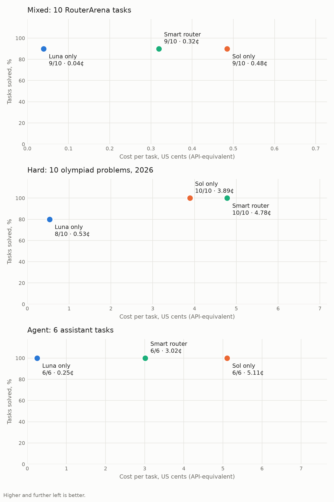

# hermes-smart-router

A Hermes plugin that picks between GPT-6 Luna and GPT-6.1 Sol on every turn when you run on a ChatGPT/Codex subscription.

Hard work goes to Sol. Everything else goes to Luna, which costs about 20x less per output token and answers faster. In our runs that came out 30–40% cheaper and somewhat faster than Sol-only, with the same answers.

## Setup

```sh
hermes plugins install dhvcc/hermes-smart-router
hermes plugins enable hermes-smart-router
hermes auth add openai-codex          # sign in with ChatGPT; skip if already signed in
hermes config set model.provider openai-codex
hermes config set model.default gpt-6.1-sol
```

Restart Hermes, and the gateway if you use one, to load the plugin.

The installer asks for an OpenAI API key and saves it to the profile's `.env` as `OPENAI_API_KEY`. If that isn't set, the plugin uses `VOICE_TOOLS_OPENAI_KEY`, which Hermes already uses for voice. Without a working key the plugin does nothing. Your Codex login stays with Hermes; the plugin never touches it.

The key pays for one [Decisions API](https://developers.openai.com/api/docs/guides/decisions) call per turn: $0.10 per 1M input tokens with output free, so a fraction of a cent. ChatGPT Pro and Business plans include monthly API credits that cover it.

For long contexts, set `model.default` to `gpt-6.1-sol-900k`. It is routed to `gpt-6-luna-900k`, so both sides always have the same context window and Hermes compaction behaves as usual.

## How it works

1. **Classify the turn.** The Decisions API reads the new message and the last few messages and labels the turn light, standard or heavy. "Continue" after a debugging session counts as heavy. Any 30% chance of heavy counts as heavy, because a wrong "heavy" costs a bit of money and a wrong "light" costs answer quality.
2. **Heavy goes to Sol**, at your reasoning effort.
3. **Light and standard go to Luna**, at `medium` and `high` effort, never above yours. The exception is when leaving Sol would let a large prompt cache expire right before you probably need Sol again. The router prices both options with Hermes's official rates, the real cache state of each model and your pace, and keeps Sol only if that is cheaper.
4. **One model per turn.** Tool loops never switch mid-turn.

The model is chosen inside Hermes's Responses transport, before Hermes builds the request. Hermes's own history conversion, reasoning replay, streaming, retries and fallbacks stay unchanged.

If anything goes wrong, Hermes behaves as if the plugin weren't installed. The plugin never retries on its own:
- A failed routed call hands the rest of the turn back to Hermes.
- A rate-limited or missing model is skipped for a while.
- If the Decisions API fails, routing pauses for 5 minutes. A rejected key turns routing off until restart.

## Privacy and requirements

- Each user turn sends the new message and up to six recent user and assistant messages (text only; earlier messages cut to 2,000 characters, the new one to 4,000) to `api.openai.com/v1/decisions`, using your OpenAI API key. Tool output and files are not sent.
- The plugin makes no other network calls, writes no files, stores no credentials and sends no telemetry. Decisions are logged to Hermes's `agent.log` without message text.
- The model is swapped by a subclass of Hermes's Responses transport, registered through `agent.transports.register_transport`. This needs the default `plugins.isolation: in_process`; under `host` isolation the plugin refuses to load and Hermes runs normally.

## Settings

All optional, in `config.yaml`:

```yaml
plugins:
  entries:
    hermes-smart-router:
      settings:
        mode: route            # or shadow: log decisions without changing anything
        light_model: gpt-6-luna
        heavy_model: gpt-6.1-sol
        light_effort: medium
        standard_effort: high
        skip_platforms: [cron]
        cache_ttl_seconds: 300
```

Each decision is logged to `logs/agent.log`:

```
smart-router: session=… tier=light (p_heavy=0.02) -> gpt-6-luna/medium, prompt~10k tokens, cheaper by $0.0136
```

## Eval

Eight assistant scenarios on a real Hermes agent with terminal and file tools, two runs per mode: auditing receipts, reconciling a bank statement, investigating logs, fixing bugs, scheduling across time zones, a KPI report, handbook questions and inbox triage. The data is synthetic and generated for this eval, and every output row and value is checked. Details in [docs/eval.md](docs/eval.md).

| Mode | Quality | Cost per session | Time per session |
|---|---|---|---|
| Luna only | 84% | $0.005 | 125 s |
| Sol only | 100% | $0.074 | 85 s |
| Smart router | 97% | $0.044 | 76 s |

Compared with Sol only, the router was 40% cheaper and 10% faster, at nearly the same quality. Luna alone is the cheapest but the slowest, and it fails the hardest scenario: the receipt audit scored 19% on Luna and 100% with the router, which sent it to Sol.

<picture><source media="(prefers-color-scheme: dark)" srcset="docs/eval-dark.png"></picture>

## Tests

```sh
python3 -m unittest discover -s tests
```

With the Hermes runtime on `PYTHONPATH`, the same command also runs contract tests against the real Hermes transport.

## License

MIT
