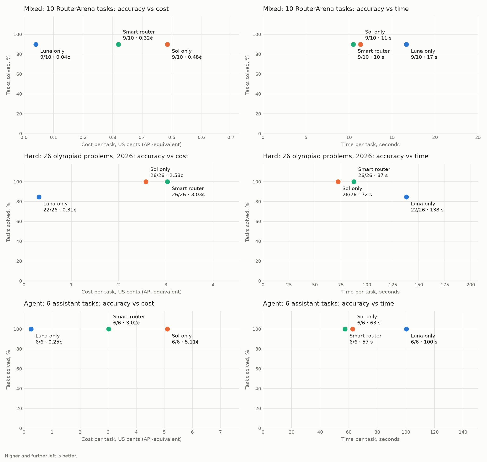

# Eval

Run on 2026-11-09. Each task is one turn of a real Hermes agent on the ChatGPT/Codex subscription, reasoning effort `xhigh`. **Luna only** and **Sol only** are plain Hermes. **Smart router** is Hermes on Sol with this plugin. Cost is API-equivalent USD from Hermes's official price snapshot, Decisions API calls included. Time is wall-clock per task. One run per task.

## All 42 tasks

| Mode | Solved | Cost per task | Time per task | Tasks on Sol |
|---|---|---|---|---|
| Luna only | 37/42 | $0.0024 | 104 s | 0/42 |
| Sol only | 41/42 | $0.0244 | 56 s | 42/42 |
| Smart router | 41/42 | $0.0238 | 65 s | 32/42 |

## Mixed: 10 RouterArena tasks

Ten tasks from [RouterArena](https://github.com/RouteWorks/RouterArena) `sub_10`: 3 easy, 3 medium, 4 hard, the first auto-gradable task of each dataset/difficulty pair. Tasks: [`eval/tasks.json`](../eval/tasks.json).

All three modes solved the same nine tasks. The router sent only the two AIME problems to Sol, cost a third less than Sol only and was the fastest. Luna alone was cheapest.

| Mode | Solved | Cost per task | Time per task | Tasks on Sol |
|---|---|---|---|---|
| Luna only | 9/10 | $0.0004 | 17 s | 0/10 |
| Sol only | 9/10 | $0.0048 | 11 s | 10/10 |
| Smart router | 9/10 | $0.0032 | 10 s | 2/10 |

| Task | Difficulty | Answer | Luna | Sol | Smart (model) |
|---|---|---|---|---|---|
| OpenTDB_General Knowledge_1807 | easy | B | ✓ | ✓ | ✓ (6-luna) |
| MedMCQA_1494 | easy | A | ✓ | ✓ | ✓ (6-luna) |
| MMLUPro_business_6 | easy | D | ✓ | ✓ | ✓ (6-luna) |
| GSM8K_43 | medium | 48 | ✓ | ✓ | ✓ (6-luna) |
| MMLUPro_engineering_10199 | medium | G | ✗ | ✗ | ✗ (6-luna) |
| MMLUPro_math_7758 | medium | C | ✓ | ✓ | ✓ (6-luna) |
| AIME_58 | hard | 24 | ✓ | ✓ | ✓ (6.1-sol) |
| AIME_112 | hard | 610 | ✓ | ✓ | ✓ (6.1-sol) |
| MMLUPro_law_1242 | hard | I | ✓ | ✓ | ✓ (6-luna) |
| MMLUPro_computer science_9414 | hard | E | ✓ | ✓ | ✓ (6-luna) |

`MMLUPro_engineering_10199`: the benchmark label is G (1/2), but a Wien bridge oscillator's feedback factor is 1/3 (E). Every mode answered E, so this miss says nothing about routing.

## Hard: 26 olympiad problems, 2026

The ten last (hardest) AIME 2026 problems and every integer-answer HMMT February 2026 problem, from [MathArena](https://huggingface.co/MathArena). Tasks: [`eval/tasks_hard.json`](../eval/tasks_hard.json).

Luna missed four of 26 and took almost twice as long as Sol. The router sent all 26 to Sol and solved every one. A turn routed to Sol sends a request byte-identical to plain Sol, which a host test checks, so the router's higher cost and time here are run-to-run variance in reasoning length. The Decisions calls cost under $0.0001 per task.

| Mode | Solved | Cost per task | Time per task | Tasks on Sol |
|---|---|---|---|---|
| Luna only | 22/26 | $0.0031 | 138 s | 0/26 |
| Sol only | 26/26 | $0.0258 | 72 s | 26/26 |
| Smart router | 26/26 | $0.0303 | 87 s | 26/26 |

| Task | Difficulty | Answer | Luna | Sol | Smart (model) |
|---|---|---|---|---|---|
| AIME_2026_11 | hard | 896 | ✓ | ✓ | ✓ (6.1-sol) |
| AIME_2026_12 | hard | 161 | ✓ | ✓ | ✓ (6.1-sol) |
| AIME_2026_13 | hard | 39 | ✓ | ✓ | ✓ (6.1-sol) |
| AIME_2026_14 | hard | 681 | ✓ | ✓ | ✓ (6.1-sol) |
| AIME_2026_15 | hard | 83 | ✗ | ✓ | ✓ (6.1-sol) |
| AIME_2026_26 | hard | 132 | ✓ | ✓ | ✓ (6.1-sol) |
| AIME_2026_27 | hard | 223 | ✓ | ✓ | ✓ (6.1-sol) |
| AIME_2026_28 | hard | 107 | ✓ | ✓ | ✓ (6.1-sol) |
| AIME_2026_29 | hard | 157 | ✓ | ✓ | ✓ (6.1-sol) |
| AIME_2026_30 | hard | 393 | ✓ | ✓ | ✓ (6.1-sol) |
| HMMT_Feb_2026_2 | hard | 420261 | ✓ | ✓ | ✓ (6.1-sol) |
| HMMT_Feb_2026_3 | hard | 48 | ✓ | ✓ | ✓ (6.1-sol) |
| HMMT_Feb_2026_5 | hard | 1230 | ✓ | ✓ | ✓ (6.1-sol) |
| HMMT_Feb_2026_6 | hard | 3840 | ✓ | ✓ | ✓ (6.1-sol) |
| HMMT_Feb_2026_8 | hard | 279 | ✓ | ✓ | ✓ (6.1-sol) |
| HMMT_Feb_2026_10 | hard | 289 | ✓ | ✓ | ✓ (6.1-sol) |
| HMMT_Feb_2026_13 | hard | 324 | ✗ | ✓ | ✓ (6.1-sol) |
| HMMT_Feb_2026_15 | hard | 252 | ✓ | ✓ | ✓ (6.1-sol) |
| HMMT_Feb_2026_17 | hard | 1574 | ✗ | ✓ | ✓ (6.1-sol) |
| HMMT_Feb_2026_18 | hard | 6992 | ✓ | ✓ | ✓ (6.1-sol) |
| HMMT_Feb_2026_19 | hard | 499 | ✓ | ✓ | ✓ (6.1-sol) |
| HMMT_Feb_2026_20 | hard | 20460 | ✗ | ✓ | ✓ (6.1-sol) |
| HMMT_Feb_2026_21 | hard | 18 | ✓ | ✓ | ✓ (6.1-sol) |
| HMMT_Feb_2026_22 | hard | 191 | ✓ | ✓ | ✓ (6.1-sol) |
| HMMT_Feb_2026_32 | hard | 10 | ✓ | ✓ | ✓ (6.1-sol) |
| HMMT_Feb_2026_33 | hard | 3037 | ✓ | ✓ | ✓ (6.1-sol) |

## Agent: 6 assistant tasks

Multi-step tool use in a throwaway folder with the terminal and file tools: totalling overdue invoices and finding a rescheduled meeting in a 17-email mailbox with a phishing look-alike, a reimbursement calculation across superseded, current and draft policy documents, a revenue report built from messy CSV/JSON data, fixing three bugs behind failing unit tests, and fixing a crashing script that is then checked on a hidden input crossing a DST change. Fixtures are in [`eval/assistant/`](../eval/assistant). Tasks: [`eval/tasks_assistant.json`](../eval/tasks_assistant.json).

All modes solved all six. The router kept the two lookup-style tasks on Luna and sent the four that need calculation or code changes to Sol: 41% cheaper than Sol only and the fastest. Luna alone was cheapest and slowest.

| Mode | Solved | Cost per task | Time per task | Tasks on Sol |
|---|---|---|---|---|
| Luna only | 6/6 | $0.0025 | 100 s | 0/6 |
| Sol only | 6/6 | $0.0511 | 63 s | 6/6 |
| Smart router | 6/6 | $0.0302 | 57 s | 4/6 |

| Task | Difficulty | Answer | Luna | Sol | Smart (model) |
|---|---|---|---|---|---|
| inbox_overdue | agent | 11,160 | ✓ | ✓ | ✓ (6.1-sol) |
| inbox_meeting | agent | 2026-11-19, 10:30, orion | ✓ | ✓ | ✓ (6-luna) |
| policy_research | agent | 3,400 | ✓ | ✓ | ✓ (6.1-sol) |
| sales_report | agent | report.md totals | ✓ | ✓ | ✓ (6-luna) |
| bugfix_tests | agent | tests pass | ✓ | ✓ | ✓ (6.1-sol) |
| script_crash | agent | hidden input output | ✓ | ✓ | ✓ (6.1-sol) |

Reproduce: `eval/run.py --mode luna|sol|smart --tasks eval/<tasks>.json --out eval/results/<set>/<mode>.json`, then `eval/report.py`.
