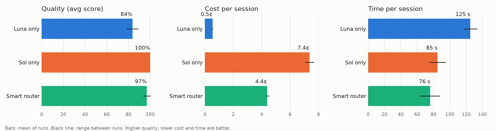

# Eval

**Smart router: 97% quality vs 100% for Sol only and 84% for Luna only, at -40% cost and -10% time compared with Sol only.**

| Mode | Quality | Cost per session | Time per session |
|---|---|---|---|
| Luna only | 84% | $0.005 | 125 s |
| Sol only | 100% | $0.074 | 85 s |
| Smart router | 97% | $0.044 | 76 s |

## Setup

Run on 2026-11-09, 8 scenarios × 2 runs per mode. Every scenario is a real Hermes agent session on the ChatGPT/Codex subscription with the terminal and file tools, in a fresh copy of a workspace. Some scenarios have a follow-up turn in the same session. Reasoning effort is `xhigh`. **Luna only** and **Sol only** are plain Hermes. **Smart router** is Hermes on Sol with this plugin.

The data is synthetic and generated from a seed by [`eval/agentic/build.py`](../eval/agentic/build.py), so it is not in any training set. The same script computes the expected results. [`eval/agentic/grade.py`](../eval/agentic/grade.py) checks every output row and value, so a scenario scores the share it got right, from 0 to 1, instead of pass or fail. Cost is API-equivalent USD from Hermes's official price snapshot, Decisions API calls included. Time is wall-clock per session.

## Per scenario

| Scenario | Luna | Sol | Smart | Smart used |
|---|---|---|---|---|
| Audit 36 expense receipts against a policy, then a follow-up question | 19% · $0.012 · 273 s | 100% · $0.086 · 108 s | 100% · $0.063 · 97 s | 6.1-sol → 6-luna |
| Match bank transactions to 25 invoices, then list top debtors | 100% · $0.003 · 63 s | 100% · $0.053 · 86 s | 100% · $0.004 · 54 s | 6-luna → 6-luna |
| Find the bad deploy and error rate in ~3,700 log lines | 100% · $0.009 · 66 s | 100% · $0.128 · 39 s | 100% · $0.129 · 46 s | 6.1-sol |
| Fix four bugs so hidden tests pass | 100% · $0.006 · 149 s | 100% · $0.109 · 160 s | 100% · $0.083 · 139 s | 6.1-sol |
| Find a meeting slot across four calendars and time zones, then the next one | 50% · $0.005 · 102 s | 100% · $0.068 · 93 s | 100% · $0.067 · 94 s | 6.1-sol → 6.1-sol |
| Monthly MRR and churn report from subscription data | 100% · $0.002 · 47 s | 100% · $0.032 · 45 s | 75% · $0.001 · 22 s | 6-luna |
| Answer six questions from a company handbook | 100% · $0.003 · 174 s | 100% · $0.053 · 73 s | 100% · $0.002 · 73 s | 6-luna |
| Triage 24 emails by written rules, then a follow-up count | 100% · $0.005 · 125 s | 100% · $0.061 · 73 s | 100% · $0.003 · 83 s | 6-luna → 6-luna |

Cells: quality · cost · time, averaged over runs. *Smart used* lists the model per turn.

Reproduce: `python3 eval/agentic/build.py`, then `eval/run.py --mode luna|sol|smart --out eval/results/<mode>-<run>.json` for each run, then `eval/report.py`.
