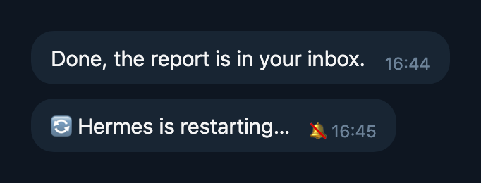

# hermes-offline-status

Hermes posts "shutting down" and "back online" to your Telegram chat on every restart, and those messages stay there forever. This plugin replaces them with one silent message that exists only while Hermes is down.



- Hermes stops: you get "🔄 Hermes is restarting…" (for `/restart` or `hermes gateway restart`) or "⏸ Hermes stopped at 16:45", with no sound.
- Hermes is back: the message is deleted.

If Hermes crashes hard (kill -9, power loss), it can't send anything.

## Install

```sh
hermes plugins install dhvcc/hermes-plugins/hermes-offline-status
hermes plugins enable hermes-offline-status
```

Turn off Hermes' own pings in `config.yaml`, then restart the gateway:

```yaml
platforms:
  telegram:
    gateway_restart_notification: false
```

This also turns off Hermes' "your turn was interrupted by a restart" notice.

The message goes to `TELEGRAM_HOME_CHANNEL`. Set `plugins.entries.hermes-offline-status.settings.language: ru` for Russian.
