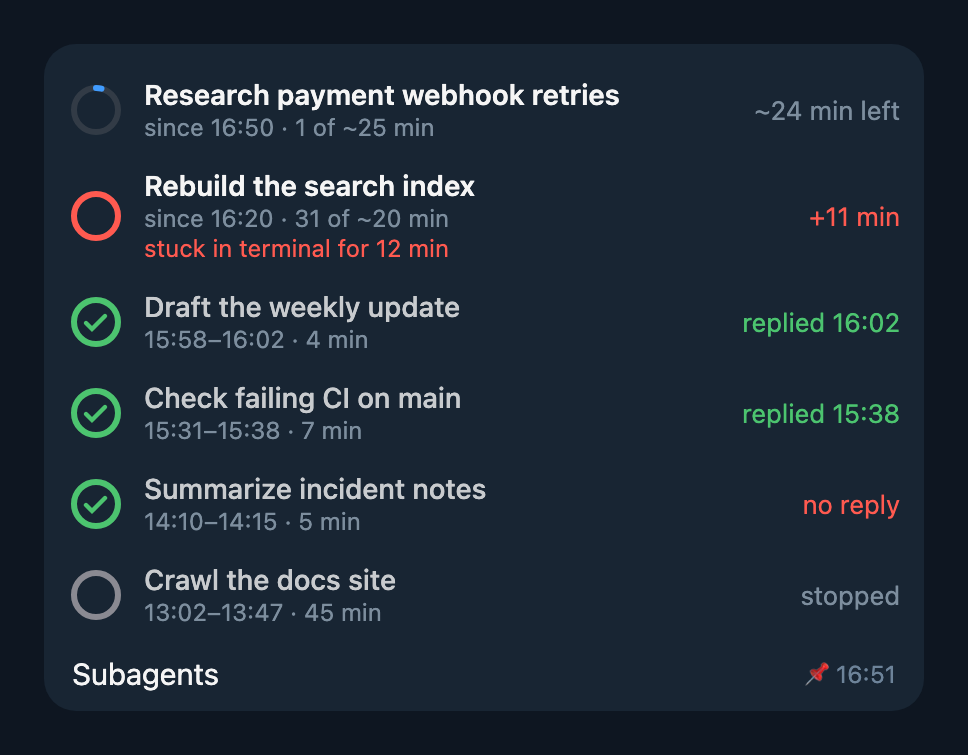

# hermes-subagent-widget

A pinned Telegram widget with your last 6 background subagents. It is one message that updates in place, so it doesn't spam the chat.



- Running: a ring that fills up toward the deadline and turns red when the subagent is late or stuck.
- Finished: how long it took, and whether the answer actually reached the chat. "no reply" means the subagent finished but you never got anything.
- Names come from Hermes' own title generator, the same one that names threads.

Deadlines come from [hermes-subagent-supervisor](../hermes-subagent-supervisor). Without it, the widget only shows elapsed time.

Telegram widgets work in private chats only, and some apps don't show them yet. Telegram for macOS, for example, shows just the caption.

## Install

```sh
hermes plugins install dhvcc/hermes-plugins/hermes-subagent-widget
hermes plugins enable hermes-subagent-widget
```

Restart the gateway.

## Settings

Put these under `plugins.entries.hermes-subagent-widget.settings`.

| Key | Default | |
|---|---|---|
| `rows` | `6` | How many subagents to show |
| `language` | `en` | `en` or `ru` |
| `pin` | `true` | Pin the widget |
| `refresh_s` | `30` | How often to update |
