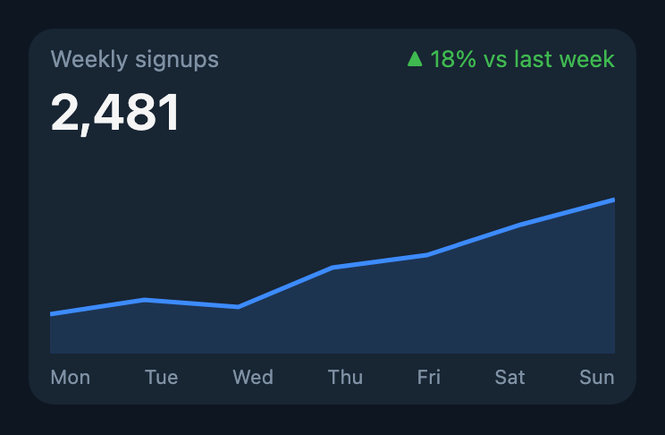
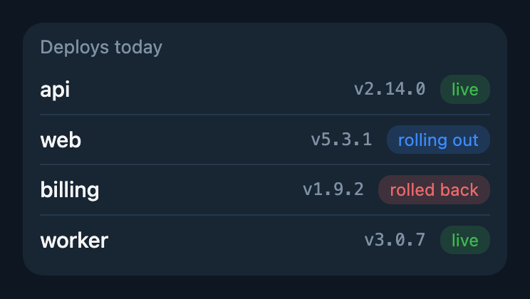
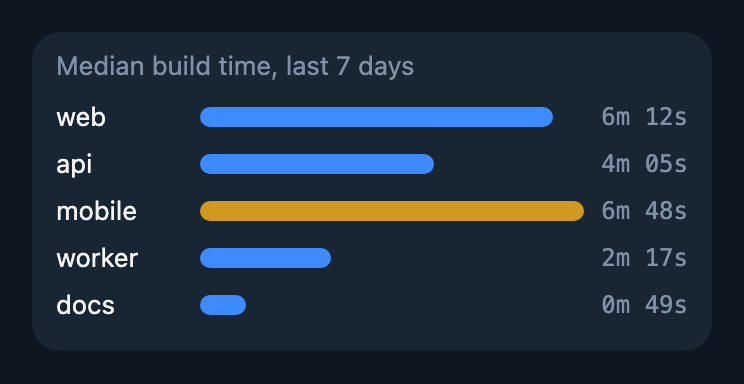

# hermes-telegram-generative-ui

Your agent draws charts, tables and status cards right in the Telegram chat, as live [bot widgets](https://core.telegram.org/bots/widgets).

<p>



</p>

Sources for these are in [examples](examples).

## How it works

One tool, `ui_render`. The agent writes a small HTML page and the plugin sends it to the current chat as a widget, above the reply. The tool description teaches the model the widget rules, and the agent is told to answer data with a trend or comparison with a chart.

The page gets theme variables (`--foreground`, `--card`, `--chart-1`…) mapped to the user's Telegram theme, so it looks right in light and dark.

Before sending, the plugin checks the page against Telegram's limits and the widget sandbox. If something would fail or be silently dropped (too big, `fetch`, external images, `<input>`, `vh` units…), nothing is sent and the agent gets the reason, so it fixes the page and tries again.

## Limits worth knowing

Widgets run in a sandbox, not a browser: 4096 bytes after zlib, 600px tall, no network, no external assets, only `<button>` as a control.

Widgets work only in the private chat with the bot. Older Telegram apps show just the caption.

## Install

```sh
hermes plugins install dhvcc/hermes-plugins/hermes-telegram-generative-ui
hermes plugins enable hermes-telegram-generative-ui
```

Needs `TELEGRAM_BOT_TOKEN`.
