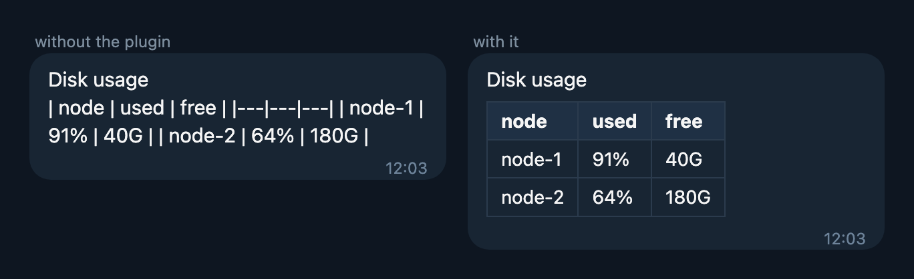

# hermes-telegram-markdown-preprocessor

Telegram's Markdown parser breaks on things models write all the time. This plugin fixes the text before Hermes sends it. It is plain code, with no LLM and no prompt rules, and takes well under a millisecond.



What it fixes:

| The model writes | Telegram shows | Fix |
|---|---|---|
| A table right under a line of text | One paragraph full of pipes | Blank line before it |
| Wrong number of columns in `\|---\|` | No table | Rebuild that row |
| `text` and then `---` on the next line | The text as a heading | Blank lines around `---` |
| A `2.` / `3.` list under a line of text | Plain text | Blank line before it |
| A line after a list or quote | Glued into the list or quote | Blank line after it |
| `<pod>`, `List<String>` | Nothing, it's deleted | `&lt;pod&gt;` |
| `#89 done` at the start of a line | A big heading | `\#89` |
| `__init__` | Bold "init" | `` `__init__` `` |
| `5 * 3 * 2` | Italic | `\*` |
| An unclosed ```` ``` ```` | Everything after it as code | Closes it |

Code and links are never touched.

## Install

```sh
hermes plugins install dhvcc/hermes-plugins/hermes-telegram-markdown-preprocessor
hermes plugins enable hermes-telegram-markdown-preprocessor
```

Restart the gateway. It works on Telegram replies only.

## Tests

`python tests/test_tgmd.py` runs offline. `tests/live_check.py` sends every case to Telegram silently, checks how Telegram parsed it, and deletes it.
